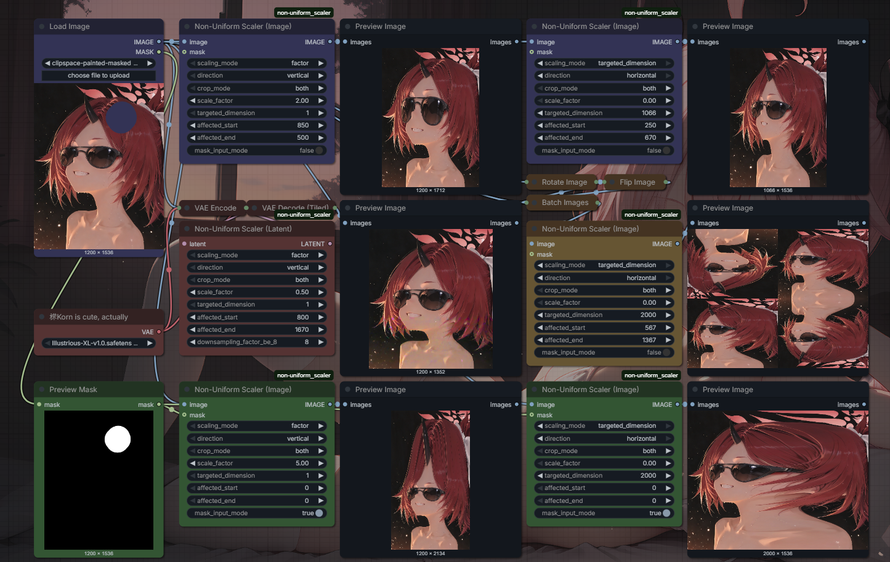
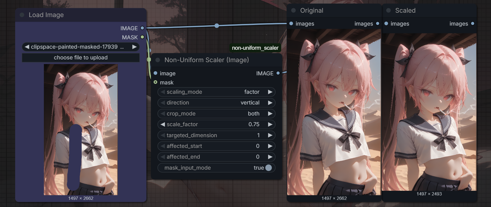
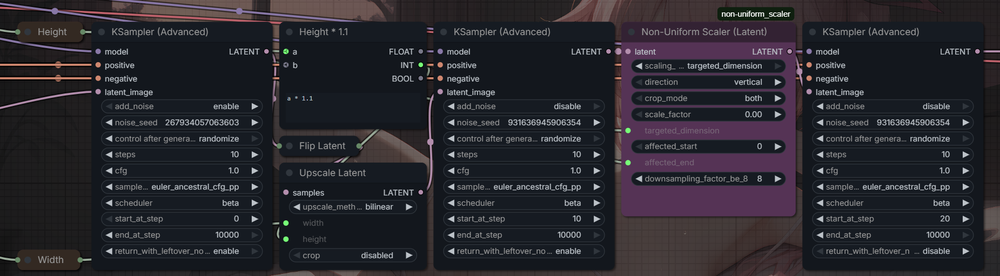
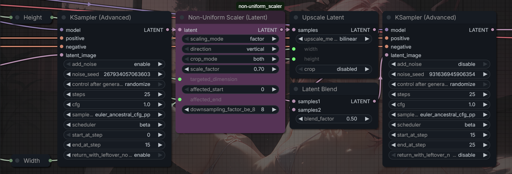

# Non-Uniform Scalers

ComfyUI custom nodes for **non-uniform scaling** image and latent along a single axis (vertical or horizontal). Made to cope, revolt, and counter-stretch against SDXL/Illustrious's characteristic distortion.


## Installation

Put dis repository into your ComfyUI `custom_nodes` folder and restart ComfyUI.
```
cd ComfyUI/custom_nodes
git clone https://github.com/strongobliquelab/non-uniform_scaler

```
## Nodes

### Non-Uniform Scaler (Image)

| Parameter            | Type     | Description |
|----------------------|----------|-------------|
| `image`              | IMAGE    | Input image batch |
| `scaling_mode`       | combo    | `factor` or `targeted_dimension` |
| `direction`          | combo    | `vertical` or `horizontal` |
| `crop_mode`          | combo    | (targeted_dimension mode only) How the node should trim some insignificant unexpected pixels, just set this to `both` tbh |
| `scale_factor`       | FLOAT    | (factor mode only) Peak scale at the centre of the affected region |
| `targeted_dimension` | INT      | (targeted_dimension mode only) Desired output length of the whole image along the chosen axis |
| `affected_start`     | INT      | Inclusive start of the region to be affected |
| `affected_end`       | INT      | Inclusive end of the region to be affected |
| `mask_input_mode`    | BOOLEAN  | Mask input mode, to use mask's edges to input `affected_start` / `affected_end` instead |
| `mask`               | MASK     | (mask_input_mode only) Optional. Vertical uses the topmost and bottommost lit rows; horizontal uses the leftmost and rightmost lit columns. |

The node would scale the image along the `direction` axis with a scale that's linear in the source-pixel space: it is one at the starting/ending edges and is `scale_factor` at the span centre.


### Non-Uniform Scaler (Latent)
It has **almost** the same controls as the image node, plus:

| Parameter                  | Type | Description |
|----------------------------|------|-------------|
| `downsampling_factor_be_8` | INT  | It is 8, is the downsampling factor, and is the ratio between a pixel unit and a latent unit. |

The `downsampling_factor_be_8` parameter is 8 (eight), for most cases, and is the downsampling factor of your VAE model. It is, again, eight because it is eight for XL models, ignore this unless you're doing rocket science with a non-XL one. Consult your distilled Gemeni-Instant-Flash-Lite for the correct downsampling factor if you use a non-XL model.

## Usage (cont.)

So... Stable Diffusion and its derivative models, including the good'ol Illustrious, are notorious for distorting details. It is painfully obvious even at 1MP and would be amplified and worsened after hi-res passes. Here, I offer a straightforward and **barbaric** solution to cope against it, which is just counter-stretching. Look at this.

That is pretty much post-processing. You use the mask input mode when you need precise control over where to stretch.

Anyway, in case you didn't notice hard enough, the SDXL/Illustrious's distortion is characteristically strongest at the centre of the image; you probably want to counter-stretch your work there. Here, you can put the node between your denoise nodes, with triple passes.


As a proof of concept, I also made this [universal deslop stretcher](workflows/deslop_stretching.json) that's based entirely on that theory


You may, and should use **Kohya Deep Shrink** together with this pack as it helps solving the exact same problem as my pack does, in case you don't know its existence. That's it, bye bye.